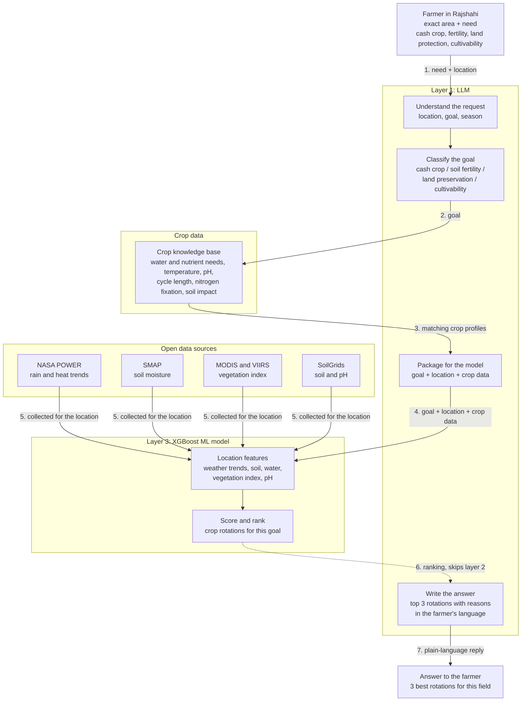

# NASA API Gateway — Bangladesh Agroclimatology & Satellite Intelligence

High-performance FastAPI service providing unified access to NASA Earth observations, soil physical-chemical profiles, satellite vegetation indices, and pre-compiled 10-year (2016–2026) monthly climate vectors for Bangladesh.

---

## Features

- **NASA POWER Integration:** Real-time & historical daily/monthly precipitation, temperature, and soil wetness.
- **ISRIC SoilGrids:** Topsoil & subsoil pH, organic carbon (SOC), nitrogen, and texture fractions (0–60 cm depth-weighted).
- **NASA AppEEARS Satellite Jobs:** Asynchronous extraction of SMAP root-zone soil moisture and MODIS 16-day NDVI/EVI vegetation time series with VCI anomaly detection.
- **10-Year Climate Dataset (2016–2026):** 130 consecutive monthly observations covering all 64 districts of Bangladesh and 70 upazilas of Rajshahi Division.
- **Interactive Geospatial Map (`map.html`):** Dark-mode responsive vector viewer featuring live timeline playback (2016–2026), dynamic parameter switching (Water Stress, Rain, Temp, Wetness), click-to-inspect analytical cards, and trend charting.
- **Auto-Seeding Storage:** Self-healing SQLite cache (`engine.db`) that automatically seeds climate data from CSV on first launch.

---

## Web Interfaces

| Route | Interface | Description |
|---|---|---|
| `GET /` or `GET /map` | **Interactive Climate Map** | 10-Year month-by-month vector choropleth map for all 64 districts & Rajshahi upazilas |
| `GET /dashboard` | **Operations Dashboard** | Real-time cache health, saved farm locations, and stress snapshot charts |
| `GET /tester` | **API Tester** | Interactive browser console for testing all REST endpoints with live payload inspection |
| `GET /docs` | **Swagger UI** | Complete OpenAPI specification with interactive "Try it out" feature |

---

## API Endpoints

### 1. Satellite & Environmental Services (Requires `X-API-Key: ge_...`)

| Endpoint | Method | Description |
|---|---|---|
| `/v1/weather` | `GET` | NASA POWER rainfall, temperature (mean, max, min), and rootzone wetness |
| `/v1/soil` | `GET` | ISRIC SoilGrids pH, SOC, nitrogen, clay, sand, silt (0–60 cm) |
| `/v1/smap` | `GET` | NASA AppEEARS SMAP root-zone soil moisture (async job) |
| `/v1/vegetation` | `GET` | NASA AppEEARS MODIS NDVI, EVI, and VCI drought anomaly (async job) |
| `/v1/field-profile` | `GET` | Combined weather, soil, SMAP, vegetation & 0–100 water-stress score |
| `/v1/locations` | `GET`, `POST` | Save and list farm coordinates with historical stress snapshots |
| `/v1/locations/{id}` | `DELETE` | Delete saved farm location and history |

### 2. 10-Year Climate Data Endpoints (2016–2026)

| Endpoint | Method | Query Parameters | Description |
|---|---|---|---|
| `/v1/climate/monthly` | `GET` | `area`, `district`, `year_month`, `year`, `area_type`, `limit` | General monthly climate query across districts and upazilas |
| `/v1/bangladesh/monthly` | `GET` | `division`, `district`, `year_month`, `year`, `limit` | 64-District nationwide monthly query |
| `/v1/rajshahi/monthly` | `GET` | `area`, `district`, `year_month`, `year`, `area_type`, `limit` | Rajshahi Division districts & upazilas query |

### 3. Static Vector & Dataset Downloads

- `GET /bangladesh_districts_vector.geojson` — 64 District vector boundaries with centroid coordinates.
- `GET /bangladesh_upazilas_vector.geojson` — 544 Upazila vector boundaries with centroid coordinates.
- `GET /bangladesh_10years_monthly.csv` — Full 64-district 130-month CSV download.
- `GET /bangladesh_districts_10years_monthly.json` — 64-district 130-month JSON records.
- `GET /bangladesh_divisions_summary.json` — 8-Division 10-year statistical summary.
- `GET /bangladesh_upazilas_10years_monthly.csv` — Full upazila-level 130-month CSV download.
- `GET /bangladesh_upazilas_10years_monthly.json` — Full upazila-level 130-month JSON records.
- `GET /rajshahi_10years_monthly.csv` — Rajshahi Division 10-year monthly CSV.
- `GET /rajshahi_nasa_polygons.geojson` — Rajshahi Division boundary polygon.
- `GET /rajshahi_satellite_vegetation_all.csv` — Aggregated MODIS NDVI/EVI vegetation time series.

---

## Setup & Configuration

### Prerequisites
- Python 3.10+
- (Optional) NASA Earthdata login credentials for submitting new AppEEARS SMAP/MODIS jobs.

### Installation

```bash
cd NasaAPIgateWay
python -m venv .venv
source .venv/bin/activate  # On Windows: .venv\Scripts\activate
pip install -r requirements.txt
cp .env.example .env
```

### Environment Variables (`.env`)

```env
EARTHDATA_USER=your_earthdata_username
EARTHDATA_PASS=your_earthdata_password
ADMIN_KEY=YourSecureAdminPassword123!
ENGINE_DB=engine.db
CORS_ORIGINS=*
SMAP_PRODUCT=SPL4SMGP.008
VEG_PRODUCT=MOD13Q1.061
REFRESH_HOURS=6
```

### Running the Server

```bash
uvicorn main:app --reload --host 0.0.0.0 --port 8000
```

On first startup, the console displays a generated default API key starting with `ge_`. You can also create additional keys using `/admin/keys` with your `ADMIN_KEY`.

---

## Layer 3 XGBoost ML Model & Crop Rotation Recommendation Engine (`architecture.mermaid`)

The system follows the 3-layer architecture defined in `architecture.mermaid`:



### ML Features & Architecture
- **Layer 1 (LLM/NLU):** Natural language intent parser, goal classification into `cash_crop`, `soil_fertility`, `land_preservation`, or `cultivability`, and bilingual explanation generator (English & Bengali).
- **Layer 2 (Crop Data):** 32 FAO-56 crop profiles with nutrient uptake, cycles, temperature, pH envelopes, and multi-season rotation templates (Rabi ➔ Kharif-I ➔ Kharif-II).
- **Layer 3 (Core ML):** High-precision XGBoost Regressor (histogram gradient boosting, R² > 0.99) trained on 68,510+ real NASA upazila monthly climate records, MODIS NDVI/EVI satellite time series, and ISRIC SoilGrids.
- **Live-Updatable:** Continuous online warm-start retraining (`xgb_model=booster`) with atomic in-memory hot-swapping and version tracking.

### Machine Learning Endpoints

| Endpoint | Method | Description |
|---|---|---|
| `POST /v1/ml/recommend` | `POST` | Full end-to-end pipeline: natural language query / goal ➔ NASA features ➔ XGBoost ranking ➔ Top 3 rotations with plain-language reasons |
| `POST /v1/ml/update` | `POST` | Live online incremental update of the active XGBoost model in memory without service downtime |
| `POST /v1/ml/retrain` | `POST` | Full retraining across all historical NASA climate records |
| `GET /v1/ml/status` | `GET` | Active model version, R², MAE, RMSE, total samples, and feature importance rankings |
| `GET /v1/ml/rotations` | `GET` | List all predefined crop rotation templates with agro-ecological metrics |
| `GET /v1/ml/crops` | `GET` | List all 32 FAO-56 crops in the knowledge base |
| `GET /ml` or `GET /dashboard/ml` | `GET` | Interactive browser dashboard visualizer with live query execution, goal selector, and live update trigger |

