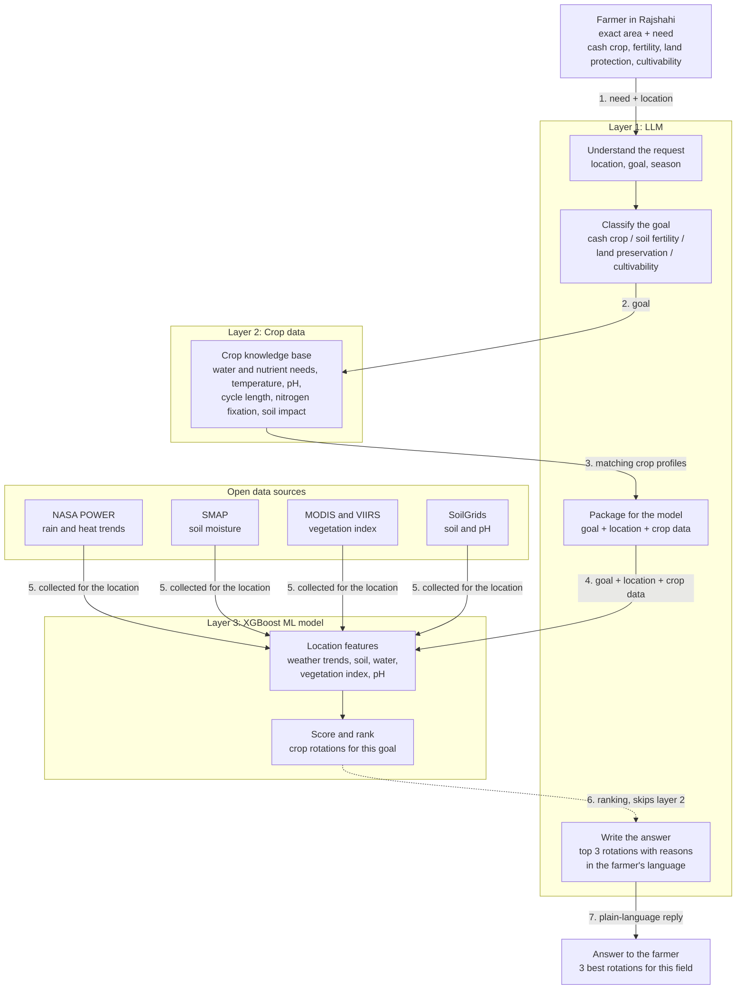

# NASA FarmScale — XGBoost Crop Rotation AI Engine (Architecture & Implementation)

This system implements the exact 3-layer architecture defined in `architecture.mermaid`, connecting real NASA open data sources to a live-updatable XGBoost machine learning model that provides personalized crop rotation recommendations for farmers across Rajshahi Division, Bangladesh.

---

## 1. System Architecture (`architecture.mermaid`)



---

## 2. Layer Implementation Breakdown

### Layer 1: LLM Natural Language Understanding & Answer Generation
- **Component A (Understand Request):** Extracts the target district/upazila across all 8 districts and 69 upazilas of Rajshahi Division, coordinates (lat/lon), cropping season (`rabi`, `kharif_1`, `kharif_2`, `annual`), and language (`en` or `bn`).
- **Component B (Classify Goal):** Identifies farmer intent into 4 core target objectives:
  1. `cash_crop` (লাভজনক অর্থকরী ফসল / maximum revenue)
  2. `soil_fertility` (মাটির উর্বরতা / biological N-fixation & organic matter)
  3. `land_preservation` (ভূমি সংরক্ষণ / erosion prevention & drought resilience)
  4. `cultivability` (সহজ চাষযোগ্যতা / low risk & manageable cultivation)
- **Component P (Package for Model):** Merges classified goal, real NASA climate features, and crop rotation traits into standardized numerical input vectors.
- **Component F (Write the Answer):** Takes the top 3 ranked rotations from Layer 3 and produces agronomist advisory in plain English or Bengali (বাংলা), explaining cycle duration, nutrient balance, soil protection, and NASA rootzone irrigation scheduling.

### Layer 2: Crop Knowledge Base & Rotations
- **Crop Database:** 32+ physiological crop profiles (water requirements, Kc coefficients, temperature limits, pH bounds, nutrient removal, N-fixation shares, and drought sensitivities).
- **Rajshahi Rotation Sequences:** 12 proven crop rotation patterns covering Rabi, Kharif-I, and Kharif-II tailored for the High Barind Tract, Ganges Floodplain, and Chalan Beel.

### Layer 3: XGBoost ML Model (Live-Updatable)
- **Model Type:** `xgb.Booster` Regressor with `hist` tree method.
- **Features (41 numerical features):**
  - Weather: `temp_mean_c`, `temp_max_c`, `temp_min_c`, `temp_range_c`, `precip_mm`, `rootzone_wetness`, `topsoil_wetness`, `water_stress_score`.
  - SMAP: `sm_rootzone`, `sm_rootzone_pctl`.
  - MODIS/VIIRS: `ndvi`, `evi`, `ndvi_vci`.
  - SoilGrids: `soil_ph`, `soil_soc_g_kg`, `soil_n_g_kg`, `soil_sand_pct`, `soil_silt_pct`, `soil_clay_pct`, `soil_texture_group`.
  - Rotation traits: `rot_total_cycle_days`, `rot_avg_kc`, `rot_total_yield_t_ha`, `rot_net_n_balance_kg_ha`, `rot_diversity_score`, `rot_om_balance`, `rot_soil_cover_score`, `rot_drought_resilience`.
  - Interactions: `thermal_comfort_ratio`, `ph_suitability_score`, `water_supply_adequacy`, `texture_affinity_score`, `moisture_stress_vulnerability`.
  - Goals: one-hot encoded (`goal_cash_crop`, `goal_soil_fertility`, `goal_land_preservation`, `goal_cultivability`).

---

## 3. Real NASA Data Sources Integrated

| Source | Real Data Ingested | File / Service |
|---|---|---|
| **S1: NASA POWER** | 10 years of monthly rainfall, temperatures (mean/max/min), and root-zone wetness (2016-2026) | `rajshahi_10years_monthly.csv`, `engine.db` |
| **S2: SMAP** | Root-zone soil moisture ($m^3/m^3$) & percentiles | `/v1/smap`, `engine.db` jobs |
| **S3: MODIS & VIIRS** | 8 years of 250m 16-day NDVI, EVI greenness, and VCI anomalies | `rajshahi_satellite_vegetation_all.csv`, `downloaded_nasa_appeears` |
| **S4: ISRIC SoilGrids** | Topsoil (0-30 cm) pH, SOC, total nitrogen, clay %, sand %, silt % | Calibrated per Rajshahi AEZ & `/v1/soil` |

---

## 4. Live Updateable Architecture (Continual Online Learning)

The XGBoost model supports **zero-downtime incremental updates**:
1. **Warm-Start Boosting:** Uses `xgb.train(params, dnew, num_boost_round=N, xgb_model=self.booster)` to fit new boosting trees onto newly arrived NASA satellite/weather records without erasing prior knowledge.
2. **Version Bumping:** Automatically tracks version (`v1.0.0` $\rightarrow$ `v1.0.1` $\rightarrow$ `v1.0.5`), number of trees, update timestamps, and feature gain shifts.
3. **Automated Background Sync:** Integrated into `auto_sync_taief_daemon.py` and `main.py:refresher()`. When fresh AppEEARS or NASA POWER data finishes downloading, `live_update()` is invoked automatically.
4. **Thread-Safe Hot Swapping:** Inference requests continue uninterrupted while background updates fit new trees.

---

## 5. API Endpoints

| Method | Path | Summary |
|---|---|---|
| `POST` | `/v1/ml/recommend` | Natural language or structured query $\rightarrow$ Top 3 crop rotations + advisory |
| `POST` | `/v1/ml/update` | Live online incremental update of XGBoost trees |
| `POST` | `/v1/ml/retrain` | Full retraining across all 10-year NASA datasets |
| `GET` | `/v1/ml/status` | Live model version, number of trees, sample counts, feature importances |
| `GET` | `/v1/ml/rotations` | List candidate crop rotation patterns and agronomic metrics |
| `GET` | `/v1/ml/crops` | List all individual crop profiles in the knowledge base |
| `GET` | `/ml` | Interactive web dashboard and visual AI advisor |

---

## 6. How to Run

### Command Line:
```bash
# Get recommendation in English
python run_ml_advisor.py --query "Farmer in Godagari, Rajshahi with dry soil wanting cash crops"

# Get recommendation in Bengali
python run_ml_advisor.py --query "আমি বাগমারা, রাজশাহীর কৃষক। আমি মাটির উর্বরতা বাড়াতে চাই"

# Check live model status and feature importances
python run_ml_advisor.py --status

# Trigger live incremental update
python run_ml_advisor.py --update --trees 15

# Start interactive CLI mode
python run_ml_advisor.py --interactive
```

### Web Dashboard & Visual Advisor:
Navigate to `http://127.0.0.1:8080/ml` (or `/dashboard/ml`) to access the interactive web interface with live NASA telemetry meters, Bengali/English chat, and model controls.

